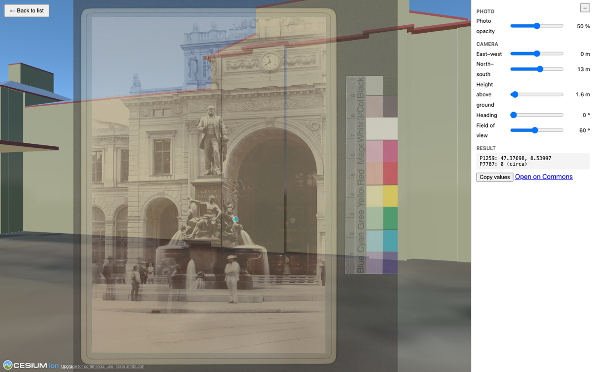

# Wiki QLever — Turn Wikimedia Commons Photos into Data You Can Play With

**Try it first:** the [camera position viewer](https://nbtkmy.github.io/wiki-qlever/). It is a static web page. It asks Wikimedia Commons, through QLever, which photos have a depicted place but no camera position, and lets you line a photo up with Swiss 3D buildings. No server, no login.

*An 1889 photograph of the Alfred Escher monument at Zürich Hauptbahnhof (Robert Breitinger, public domain, [Zentralbibliothek Zürich on Commons](https://commons.wikimedia.org/wiki/File:Zentralbibliothek_Z%C3%BCrich_-_Escherdenkmal_-_991028231679705501.jpg)), faded over swisstopo 3D buildings in CesiumJS. The camera sits at about the position stored in this file's structured data.*

That page only works because Commons stores *structured data* about its files, and anyone can query it with SPARQL. A file is not only a picture with a caption: it can say what it shows, where it was taken, from which direction, and which institution holds it. Once such statements exist, a few lines of static code are enough to put photos on a 3D map. The infrastructure is open, shared and free for everyone.

**The challenge:** Pick a large collection on Wikimedia Commons. Can we find out, with one query, which images are still missing this data, suggest the missing statements, and let a human confirm them? And can we build it so that it works for the next collection too?

## What becomes possible

Every statement we add unlocks something. Some ideas, from ready to ambitious:

- **Photos in 3D.** Historic photos placed at their camera position in a 3D view of today's landscape (the viewer above does this for one photo at a time).
- **Viewing directions on a map.** Where was the camera, and what was it pointing at? Draw it for a whole collection of historic aerial photographs.
- **One mountain, many archives.** All photos of the same peak, bridge or building from different institutions, side by side.
- **A whole institution in one query.** With the *collection* statement (`P195`), one query returns every file of an institution, with its metadata. No scraping, no category walking.
- **Training data.** `depicts` (`P180`) can carry a position inside the image (`P2677`). Together with geodata, that is a starting point for labelled data for computer vision. We have not tried this yet.
- **A map of what is still missing.** Which collection is nearly complete, which one is almost empty? Show it to the institutions.

## Why it does not work for most collections yet

Most bulk-uploaded collections carry little of this data. In a random sample of 600 files from the ETH Library collection (60,449 files), about nine in ten have no `depicts` statement and only 3 have a camera position (`P1259`). The `P195` statement exists on about 8.2 million Commons files (as of 23 October 2026), mostly from US institutions. Zentralbibliothek Zürich uses it, and one query returns its 7,224 files. For the other Swiss collections we checked, it is missing or nearly so.

These are collections we picked, not a survey of all Swiss institutions. The measurements and a chart are in [`docs/qlever-commons.md`](docs/qlever-commons.md).

## How we get there

**collection → QLever gap detection → suggested statements → human validation → Structured Data on Commons**

1. **Select a collection.** Preferably with `P195`, otherwise by Commons category or file-name prefix.
2. **Detect gaps with QLever.** List the files without `depicts`, without coordinates, or without heading.
3. **Suggest statements** from the file name, the caption, and the image itself:
   - `depicts` (`P180`): landmarks, places, people and objects, matched to Wikidata.
   - Camera position `P1259` and depicted place `P9149`, both as approximate coordinates, with the heading `P7787` as a qualifier. Phrases such as *vom Vulcan-Hôtel* or *gegen Süd* give hints. Careful: "seen from the north" means the camera points south.
4. **Validate by a human.** A reviewer accepts, rejects or picks another candidate. Every suggestion records its source, for example "inferred from file name". Suggestions from file names alone are not safe, so a human decides.
5. **Export** the accepted statements for Commons (for example as QuickStatements) instead of writing directly.

The pipeline is generic: a collection is an input, not a hard-coded part.

## Where we start

We start with the ETH Library files (`Category:Media contributed by the ETH-Bibliothek`) and Zentralbibliothek Zürich: large, bulk-uploaded and mostly unannotated. The Aargau society collection ([challenge #319](https://hack.glam.opendata.ch/project/319)) is a possible second test case. Our pipeline complements that challenge, which is about place names and coordinates for the same collection.

Already done:

- Gap measurements with QLever for five collections.
- A hand-checked test of matching file names and image content to Wikidata items, with its failure cases.
- A manual write test on one Commons file: approximate camera position, heading and depicted place saved as structured data. A heading cannot carry an uncertainty on Commons, so the pipeline has to keep it.
- The [3D viewer](viewer/) for correcting camera positions.

## Who we are looking for

- People who like **maps, 3D and visualisation**: what would you build on top of this data?
- People who know **Wikimedia Commons, Wikidata or SPARQL/QLever**.
- People who work with **cultural heritage collections** and can tell a right suggestion from a wrong one.
- People who build **user interfaces** for reviewing suggestions, or who work with **computer vision**.

The question behind the project: how can we turn millions of openly available cultural heritage images into a connected, searchable and reusable knowledge graph, on infrastructure that everyone can use?

## Repository

This repository contains the documents and code for the project "wiki-qlever" at the [GLAMhack 2026](https://hack.glam.opendata.ch/event/13).

- [`docs/qlever-commons.md`](docs/qlever-commons.md): guide to the QLever endpoint for Commons, with all measurements and test results mentioned above.
- [`presentations/assets/`](presentations/assets/): screenshot and charts used in this description and in the docs.
- [`viewer/`](viewer/): the 3D viewer for correcting camera positions of Commons photos (see its README).
