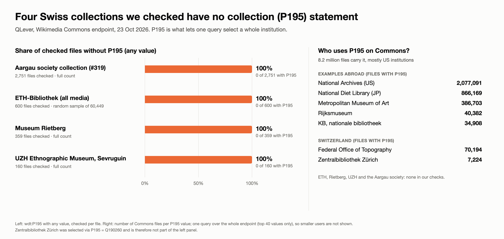

## Wiki QLever — A Reusable Pipeline for Finding and Filling the Gaps in Wikimedia Commons

Swiss GLAM institutions such as ETH Library, Zentralbibliothek Zürich, and many others have made large image collections available through Wikimedia Commons.

But making an image available is only the first step.

Many of these images still lack structured information about what they depict, where they were taken, and which institution they belong to. Without it, valuable cultural heritage remains hard to discover, map, and reuse.

**Wiki QLever** uses QLever's SPARQL endpoint for Wikimedia Commons to measure these gaps and to help close them. We do not build a tool for one collection. We build a **generic pipeline** that works for any collection, and we test it on real ones.

**The pipeline**

**collection → QLever gap detection → suggested statements → human validation → Structured Data on Commons**

1. **Select a collection.** Preferably by institution, using the *collection* statement (`P195`). Where that is missing, by Commons category or file-name prefix.
2. **Detect gaps with QLever.** Count and list files without `depicts`, viewpoint, or heading.
3. **Suggest statements.** From the file name, the caption, and the image itself:
   - `depicts` (`P180`): landmarks, places, people, and objects, matched to Wikidata. This is the main part.
   - Camera position: `P7108` (location of the point of view) from phrases such as *vom Vulcan-Hôtel*, and `P1259` (coordinates) taken from that item as an approximation, not a precise value.
   - Camera direction: `P7787` (heading) from phrases such as *gegen Süd* or *von N.* (careful: "seen from the north" means the camera points south).
   - Field of view (`P4036`) is part of the data model, but we do not expect to derive it for historic photographs.
4. **Validate by a human.** A reviewer accepts, rejects, or picks another candidate. Every suggestion records where it came from, for example "inferred from file name".
5. **Export** the accepted statements for Commons (for example as QuickStatements), instead of writing directly.

**Why institutions should register the collection (`P195`)**

With `P195`, one query selects a whole collection, for example all 7,224 files of Zentralbibliothek Zürich. Without it, selection needs workarounds such as walking Commons categories.

`P195` is widely used on Commons: about 8.2 million files carry it, mostly from US institutions (National Archives, Metropolitan Museum, public libraries), but also the Rijksmuseum, the National Diet Library of Japan, and in Switzerland the Federal Office of Topography and Zentralbibliothek Zürich. In four other Swiss collections we checked in October 2026, none of the files has it:

- ETH Library: no `P195` in a random sample of 600 out of 60,449 files; about 91% of the sample also has no `depicts`.
- Aargau society collection (challenge #319): no `P195` on any of its 2,751 indexed files, and `depicts` on only 10 of them.
- Museum Rietberg and the UZH Ethnographic Museum (Sevruguin photos): no `P195`.

These are four collections we picked, not a survey of all Swiss institutions. We want to encourage institutions to add the collection statement, and to show what is missing.

**What do we get when the data is there?** We will show a few examples on real data, for instance:

- a map of a collection from camera positions,
- the viewing direction of historic aerial photographs drawn on a map,
- a comparison of institutions by how complete their metadata is,
- finding all photos of the same mountain or object across institutions,
- spotting file names that do not match the content.

Our approach complements the challenge about place names and coordinates for the Aargau society collection (#319): the pipeline can serve that collection as one of its test cases.

For the hackathon we will build the pipeline end to end for one or two collections, with a simple review interface. Possible extensions are AI-assisted object recognition, image-region annotations, and direct upload to Commons.

The larger question behind the project is simple:

**How can we turn millions of openly available cultural heritage images into a more connected, searchable, and reusable knowledge graph?**

We are looking for people interested in Wikimedia Commons, Wikidata, SPARQL/QLever, cultural heritage collections, user interfaces, or computer vision.
