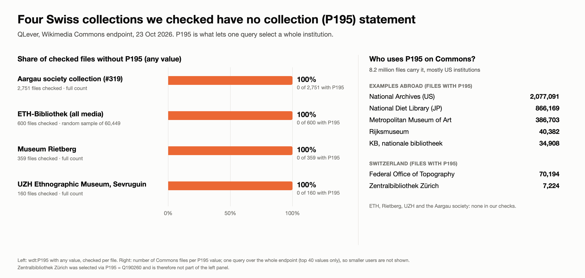

# Collections: selecting files and measuring gaps

Which Swiss collections can be selected with SPARQL, and how many of their files lack `depicts`? Measurements from October 2026. For endpoint basics see [`qlever-basics.md`](qlever-basics.md).

## Selecting a collection

- **Collection tagging is not uniform.** `P195` (collection) works for Zentralbibliothek Zürich, but not for the others we tried:
  - ETH Library (Q684773) and Image Archive of ETH Library (Q40236085): only a handful of files via `P195` or `P7482` (source of file). Two sampled ETH files carried no collection or source statement at all.
  - Museum Rietberg (Q668300): 721 files via `P170` (creator), all with `depicts` already; `P195` gives 0.
  - Swiss National Museum (Q691896): used as a `depicts` value (172 files), not as a collection.
  - `P7482 = Q87402110` ("own work by the original uploader") is a generic value shared by 1,946 files across uploaders, so it does not identify an institution.

  
- **Selecting files by file name works, with a catch.** QLever has no Commons categories in this index, but `schema:url` contains the file name. For ETH Image Archive, files named `ETH Bildarchiv …` / `ETH-Bibliothek Zürich, Bildarchiv - …` can be selected like this (about 20 s with `LIMIT`):

  ```sparql
  PREFIX schema: <http://schema.org/>
  PREFIX wdt:    <http://www.wikidata.org/prop/direct/>
  SELECT ?m ?u WHERE {
    ?m schema:url ?u .
    FILTER(STRSTARTS(STR(?u), "http://commons.wikimedia.org/wiki/Special:FilePath/ETH%20Bildarchiv"))
    FILTER NOT EXISTS { ?m wdt:P180 ?d }
  } LIMIT 10
  ```

  Without `LIMIT`, or with `COUNT`, the filter scans every file and hits the 60 s gateway timeout (HTTP 504), so exact totals are not available this way. Page through results with `LIMIT`/`OFFSET`, or cache them locally.
- **Commons categories need the MediaWiki API.** For example `Category:Photographs_in_the_Collection_of_Museum_Rietberg` (358 files, 2 subcategories) can be listed with `action=query&list=categorymembers`; the page IDs map directly to `M<pageid>` entities in QLever, which can then be checked for `depicts`. In a sample of three files from that category, one had no `depicts` statement.

## Candidate collections (measured October 2026)

Method: file lists come from the Commons API (`list=categorymembers`) or a `P195` query; the page IDs are then checked in QLever (`VALUES ?m { <…/entity/M<pageid>> … }` with `FILTER NOT EXISTS { ?m wdt:P180 ?d }`; use POST for long queries).

| Collection | How selected | Files | Without `depicts` |
|---|---|---|---|
| Zentralbibliothek Zürich | `wdt:P195 wd:Q190260` | 7,224 | 685 (9.5%) |
| Museum Rietberg | `Category:Collection of Museum Rietberg, Zürich` | 359 | 31 (8.6%) |
| Sevruguin photos, Rietberg | `Category:Photographs by Antoin Sevruguin in the collection of Museum Rietberg` | 271 | 2 |
| Sevruguin photos, Ethnographic Museum UZH | `Category:Photographs by Antoin Sevruguin in the collection of Völkerkundemuseum der Universität Zürich` | 160 | 0 |
| ETH-Bibliothek (all media) | `Category:Media contributed by the ETH-Bibliothek` via the Commons API, uniform random sample of 600 | 60,449 | 546 of 600 sampled (91%, 95% CI 88.7–93.3%), i.e. about 55,000 extrapolated |

Observations:

- All files in the checked Commons categories were present in the QLever index, so the index is current enough for these.
- Hand-curated small collections (Rietberg, UZH Sevruguin) are mostly annotated already. The remaining gap is concentrated in the large, bulk-uploaded archives (ZB, ETH), which makes those the better targets for a prototype. ETH-Bibliothek is by far the largest gap measured so far (see below).
- The Commons category search for "in the collection of" with Swiss place names only found a few categories, so a full list of Swiss GLAM collections will need a better source (for example the GLAM institutions' Wikidata items and their upload templates).

## ETH-Bibliothek: sampled `depicts` gap (23 Oct 2026)

`Category:Media contributed by the ETH-Bibliothek` holds 60,449 files (31 subcategories, not followed). We listed all of them with `list=categorymembers&cmtype=file` (about 120 requests of 500), drew a uniform random sample of 600 page IDs and checked them in QLever.

- All 600 were in the QLever index.
- 54 had a `wdt:P180` statement, 546 did not: **91% without `depicts`** (95% CI 88.7–93.3%), roughly **55,000 files** (53,600–56,400).
- Only the direct property `P180` was counted. A file may describe its content through other statements instead.
- 174 of the 546 are not aerial photographs (the aerial series `LBS` / `Inlandflüge` / `Nordafrikaflug` make up the rest). The non-aerial files are mostly glass slides (`Dia 247`, a Leo Wehrli collection), portraits (`Portr`), building photos (`Ans`) and photos of people and events (`Com`).
- Pitfall: starting the category listing at random sort keys (`cmstarthexsortkey`) gave a heavily clustered sample (65 distinct files from 25 starts), because file names do not spread evenly over hex keys. Enumerate the whole category first, then sample.
- Existing viewpoint statements are rare: in the same 600 files, `P1259` appears on 3 files and `P625` on none. `P9149`, `P7787` and `P4036` were not measured.

## Open questions

- Which Swiss GLAM collections can be reliably selected with SPARQL on QLever (`P195`, file-name patterns), and which need the Commons API for category membership?
- Is the ETH figure (about 91% without `depicts`) typical for other bulk-uploaded archives, and how much of it is covered by other statements (for example `P180` on a parent work, `P921`, or depicted-place `P9149`)?
